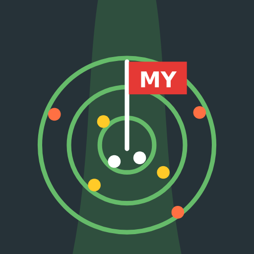

# MY GOLF

練習場で記録した自分のショットデータから、コースの攻め方を提案するゴルフアプリです。
1つのHTMLファイルだけで動き、記録はスマホの中に保存されます。

## 主な機能

- **練習場**：クラブを選び、ショットの落下位置をタップして記録
- **データ**：クラブごとの平均飛距離と曲がり傾向、コースでのあなたの癖
- **コース**：浜野ゴルフクラブ・平川カントリークラブ・PGM石岡ゴルフクラブのコースマップと、データ攻略ルートの提案
- **スコア**：ラウンドの記録、上達の推移グラフ、前回との比較（ドライバーの比較を含む）

データ攻略ルートは、記録したクラブごとの飛距離と左右・前後のばらつきをもとに、
OB・池・バンカーに入る確率を計算して、少ない打数で上がれそうなルートを探す仕組みです。
生成AIや外部のサービスは使っておらず、アプリの中の計算だけで動きます。

## ファイル

| ファイル | 内容 |
|---|---|
| `index.html` | アプリ本体（単体版）。このファイルだけで動きます |
| `icon.png` | ホーム画面用のアイコン |
| `claude-version/my-golf-claude.html` | Claudeの中で使う版（クラウド保存・Claudeに相談つき） |

## 使い方

`index.html` をサイトに置き、スマホのブラウザで開いて「ホーム画面に追加」すると、アプリとして使えます。
記録の引っ越しは、データ画面の「バックアップを保存」と「読み込む」で行います。

## 地図データ

浜野GCのコースマップは OpenStreetMap のデータをもとに作成しています。© OpenStreetMap contributors
PGM石岡GCのコースマップは国土地理院の空中写真をもとに作成しています（出典：国土地理院）。
